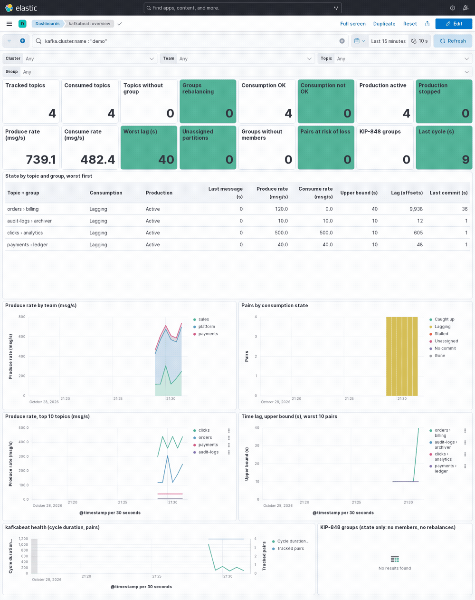

*(Version française : [README_fr.md](README_fr.md))*

# kafkabeat

[](https://github.com/gnocent/kafkabeat/actions/workflows/ci.yml)
[](https://github.com/gnocent/kafkabeat/releases)
[](LICENSE)

The **time lag** of every Kafka topic + consumer group pair, in seconds, every 10 seconds, shipped to Elasticsearch, with
example Kibana dashboards and alert rules. Built for large, high-throughput Kafka estates where Kafka is a buffer between
producers and consumers: thousands of topics and tens of thousands of partitions, where what matters is the overall
picture and reliable near-real-time signals, not millisecond latency.

## Demo

<p align="center"></p>

> [!NOTE]
> **How this project is made.** I'm not a developer: I write the specifications ([DESIGN.md](DESIGN.md)) and check the
> result; the code is written by [Claude Code](https://claude.com/claude-code). What makes up for it: unit tests run with
> the race detector, and an automated acceptance suite of 16 criteria replayed on a Docker test bench with two Kafka
> versions (3.9 and 4.4, KRaft) and two Elastic stacks (8.19 and 9.5). This is a **first public version (0.1.0)**, not yet
> run by many: what was checked, and what wasn't, is in [DESIGN.md](DESIGN.md#7-validation) and under [Security](#security).

## Why kafkabeat

Offset lag ("42,000 messages behind") says little on its own: 42,000 messages is a second on one topic and a day on
another. kafkabeat answers the question an on-call engineer actually asks, **how many seconds behind is this consumer
group**, for every pair of a cluster, at every cycle, including when consumption has stopped altogether.

- **Seconds, bracketed, never guessed.** The agent keeps a history of each partition's end offset and when it was seen.
  The lag is given as a lower and an upper bound, read from that history without interpolation or average rates. Alerts
  fire on the upper bound.
- **Made for volume.** A single static binary per cluster, reading only Kafka metadata (no application topic is ever
  read). One document per pair and per cycle, lag or not, so a silent pair is visible. Measured on a simulator: a cycle at
  30,000 partitions takes well under the 10 s interval.
- **States, not just numbers.** Each pair says what is going on: `caught_up`, `lagging`, `stalled` (committed offset frozen
  with lag), `unassigned` (a partition no member reads), `no_commit`, `gone`. Production has its own status (`active`,
  `stopped`), so a producer problem is told apart from a consumer problem at a glance.
- **The signals around the lag.** Rebalances (one document per group generation, members joined and left), partitions
  no member is assigned to, loss risk (how much of the retained log a group has not read yet, and offsets actually lost to
  retention), offset resets, recreated topics, and a health document for the agent itself.
- **Drops into an Elastic estate.** Metrics with the same names as Metricbeat's Kafka module (`kafka.partition.*`,
  `kafka.consumergroup.*`, and `kafka.broker.*` through Jolokia), so it can replace those metricsets. Data streams are
  time series (TSDS) downsampled by ILM: 7 days raw, then one value per hour up to 90 days.

What it is not: a per-message latency probe (it never reads messages), a client-side metrics collector (producer and
consumer JMX stay with Metricbeat next to the applications), or a high-availability service (one instance per cluster,
restarted by its supervisor; a gap is reported by the health document). Despite its name, it is not an Elastic Beat (it
does not use libbeat) and is unrelated to earlier projects called kafkabeat.

## What you get

| Data stream | Content |
|---|---|
| `kafkabeat-lag` | One document per topic + group pair every 10 s: lag bounds in seconds, worst partition, state, production status, rates, loss risk, flags. |
| `kafkabeat-metrics` | Every 60 s, Metricbeat-compatible partition, consumer group and (optional) broker documents. |
| `kafkabeat-events` | One document per rebalance of a classic consumer group. |
| `kafkabeat-health` | One document per cycle about the agent: cycle duration, errors, partial failures. |

And, in [kibana/](kibana/), four dashboards (overview, topic + group zoom, trends up to 90 days, broker health) and four
alert rules (time lag, silent agent, stopped production, loss risk), filtered by cluster, team, topic and group.

## Installation

Release files are on the [Releases](https://github.com/gnocent/kafkabeat/releases) page:

| Platform | File | Use |
|---|---|---|
| Linux (x86-64) | `kafkabeat-<version>-linux-amd64.tar.gz` | Production: binary, systemd unit, example configuration. |
| macOS (Apple Silicon) | `kafkabeat-<version>-darwin-arm64.tar.gz` | Trying it out. |
| Windows (x86-64) | `kafkabeat-<version>-windows-amd64.zip` | Trying it out. |

```bash
sha256sum -c SHA256SUMS --ignore-missing     # checks the downloaded archive
```

Or, with [Go](https://go.dev/) 1.27 or later: `go install github.com/gnocent/kafkabeat/cmd/kafkabeat@latest`. A
`Dockerfile` builds a minimal container image, and [deploy/](deploy/) has a systemd unit and a HashiCorp Nomad job.
Step by step, for each of these: the **[installation guide](INSTALL.md)**.

## Quick start

On a workstation with Docker, the repository's test bench gives a Kafka cluster, Elasticsearch and Kibana in a few
minutes:

1. **Start the bench**: `make bench-up` (Kafka 3.9 and 4.4, Elasticsearch and Kibana 8.19 and 9.5, local ports only).
2. **Run the agent** against it: `make check`, then `./bin/kafkabeat -config kafkabeat.example.yml`.
3. **Import the dashboards** into Kibana (`http://localhost:5601`) from `kibana/kafkabeat-examples.ndjson`.
4. **Create traffic** with the bench harness: a topic, a producer, a consumer group, then pause the consumer.
5. **Watch** the pair go from Caught up to Lagging, then Stalled, on the overview dashboard.

Every command, step by step: [installation guide, §2](INSTALL.md#2-quick-start-on-the-test-bench).

## Documentation

- **[INSTALL.md](INSTALL.md)**: quick start, then production install (archive + systemd, container + Nomad, from
  source), configuration and required permissions.
- **[USAGE.md](USAGE.md)**: day-to-day use, step by step: reading the dashboards, what each state and flag means, alert
  rules, investigating a lagging group, checking the agent's health.
- **[DESIGN.md](DESIGN.md)**: how it works and why: the bracketing method, how commits and group membership are read,
  storage, the technical choices with their benefits and limits, and how it is validated.
- **[CHANGELOG.md](CHANGELOG.md)**, **[SECURITY.md](SECURITY.md)**, test bench: [bench/README.md](bench/README.md).

## Security

**What the agent touches**

- **Kafka**: metadata, end and start offsets, consumer groups and their committed offsets; in `hybrid` mode it also reads
  the internal `__consumer_offsets` topic. It never reads an application topic and never writes to Kafka.
- **Elasticsearch**: bulk writes to its own data streams, and installation of their templates and ILM policies at startup
  (can be turned off).
- **Jolokia** (optional): read-only MBean requests to each broker.
- **Credentials** are read only from the configuration file (keep it `0600`; the systemd unit hands it over with
  `LoadCredential`) and are never logged. TLS 1.2 at least; no option disables certificate verification.

**What was checked, and what wasn't**

- Unit tests with the race detector, `go vet`, `govulncheck` in CI; the acceptance suite on the test bench.
- The test bench has no security enabled: the Elasticsearch privileges listed in [INSTALL.md](INSTALL.md) were derived
  from the API calls, not checked against a secured cluster. SASL and mTLS are implemented but not exercised by the bench.
- The systemd sandbox is checked for syntax only: validate it on the target host (`systemd-analyze security kafkabeat`).
- **No independent external audit.** Reporting a vulnerability: [SECURITY.md](SECURITY.md).

## License

This project is distributed under the **[GNU Affero General Public License v3.0](LICENSE)** (AGPLv3): you're free to use,
study, modify, and redistribute it, provided the source code (including your modifications) remains available under the
same terms — including when the software is exposed over a network.

> **Note of intent (not legally binding)**: the spirit of this project is to remain a community tool, improved
> collectively, not a product resold as-is. The AGPLv3 does not formally forbid commercial use, but that's the use its
> author hopes to see made of it.

## Disclaimer / limitation of liability

kafkabeat is published **as is**, without warranty of any kind, express or implied — including, without limitation, the
warranties of merchantability, fitness for a particular purpose, and non-infringement (see sections 15 through 17 of the
[AGPLv3 license](LICENSE), which govern).

In particular:

- This project is developed and maintained **on its author's free time**, with no commitment to availability,
  maintenance, security patches, or future evolution.
- The author and contributors **decline any responsibility** for the direct or indirect consequences of using this tool —
  including, without limitation, data loss, service interruption, or load on a Kafka or Elasticsearch cluster.
- The agent reads Kafka metadata and writes to Elasticsearch with the privileges it is given: **try it on a test cluster
  first**. Running it against a production cluster remains the sole responsibility of the person doing so.
